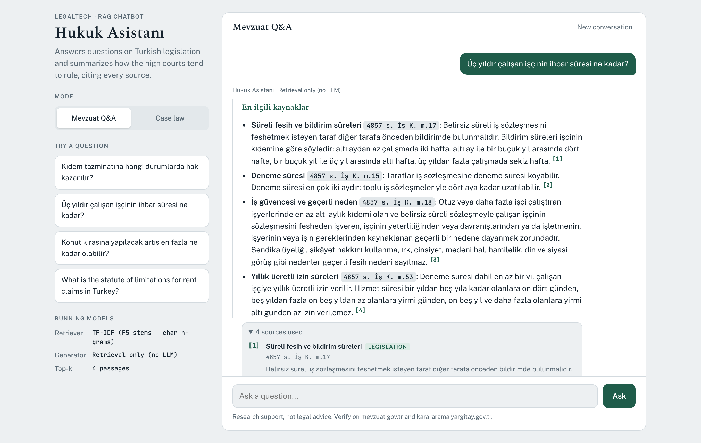
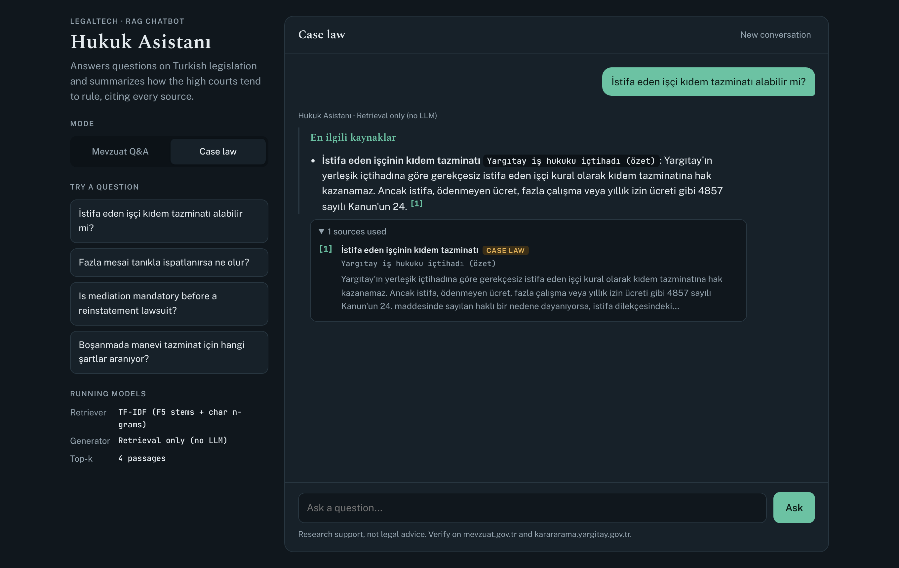
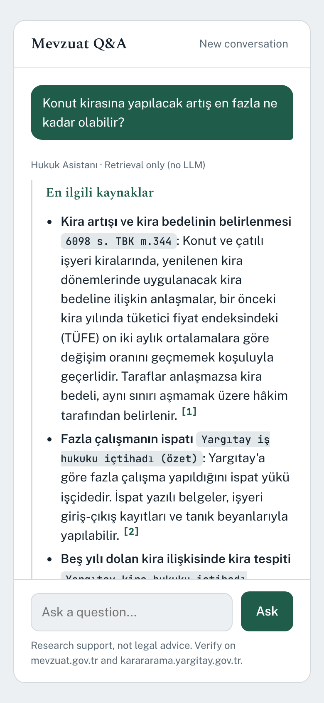
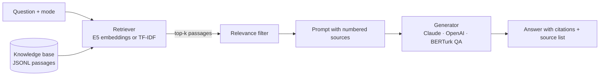
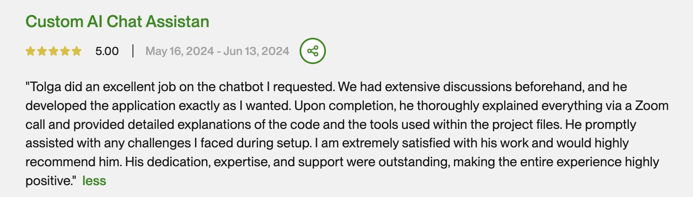

# Hukuk Asistanı: AI Legal Chatbot for Turkish Law

A retrieval-augmented (RAG) chatbot that answers questions about Turkish legislation and summarizes how the high courts tend to rule. **Every answer cites the passages it was built from.**

The project started as a freelance build for a law practice in Turkey (Upwork, 2024, rated 5.0). This repository holds the original delivery (`legacy/v1`) and a rebuilt v2 with retrieval, citations, pluggable models and tests.


## Demo

**Try it online:** [Interactive demo](https://claude.ai/artifact/Doyt4S1fadss5jS3RvPNK8). Opens with recorded example answers; signed-in claude.ai users can also ask their own questions and get live answers.

**Run it yourself in one minute** (offline, no API key or model download):

```bash
git clone https://github.com/tolgaboroglu/chatbot-for-lawyers-demo.git && cd chatbot-for-lawyers-demo
pip install -r requirements-dev.txt
RETRIEVER=tfidf GENERATOR=retrieval python -m app.server   # open http://127.0.0.1:5000
```

Then try these questions:

| Mode | Question | Expected top source |
|---|---|---|
| Mevzuat Q&A | Üç yıldır çalışan işçinin ihbar süresi ne kadar? | `4857 s. İş K. m.17` |
| Mevzuat Q&A | Konut kirasına yapılacak artış en fazla ne kadar olabilir? | `6098 s. TBK m.344` |
| Case law | İstifa eden işçi kıdem tazminatı alabilir mi? | Yargıtay case-law summary on resignation |
| Case law | Fazla mesai tanıkla ispatlanırsa ne olur? | Yargıtay case-law summary on proving overtime |

For full written answers, add `ANTHROPIC_API_KEY` to `.env` and start with `python -m app.server`.

### Screenshots



| Case-law mode (dark theme) | Mobile |
|---|---|
|  |  |

> The GIF and screenshots were recorded in offline mode (`RETRIEVER=tfidf`, `GENERATOR=retrieval`), so answers show the ranked source passages. With `GENERATOR=anthropic` the same sources are summarized into a written answer with `[1]`, `[2]` citations.

## Features

- **Two modes.** *Mevzuat Q&A* answers from statutes; *Case law* pulls case-law summaries first and suggests a search string for the official Yargıtay database.
- **Grounded answers with citations.** The model sees only the retrieved passages and must cite them; statute references such as `4857 s. İş K. m.17` are highlighted.
- **No invented case numbers.** The prompt forbids fabricated esas/karar numbers, dates and quotations.
- **Turkish-aware retrieval.** Multilingual E5 embeddings by default; an offline TF-IDF fallback uses Turkish case rules (İ/ı) and F5 stemming.
- **Pluggable models.** Swap retriever and generator with one environment variable each.
- **Bring your own documents.** `scripts/ingest.py` turns TXT, Markdown, PDF or CSV files into a searchable knowledge base.
- **Tested.** 20 offline tests cover retrieval, the pipeline and the API.

## AI models

| Role | Model | When it is used |
|---|---|---|
| Embeddings (retrieval) | [`intfloat/multilingual-e5-base`](https://huggingface.co/intfloat/multilingual-e5-base) | Default (`RETRIEVER=embedding`). Matches Turkish and English questions to Turkish passages by meaning. Any sentence-transformers model works via `EMBEDDING_MODEL`. |
| Lexical retrieval | TF-IDF with F5 stemming + character n-grams (scikit-learn) | `RETRIEVER=tfidf`. No download, no GPU; good for exact legal terms, weaker on synonyms. |
| Answer generation | **Claude** (`claude-sonnet-5-5`, Anthropic API) | Default (`GENERATOR=anthropic`). Writes the structured, cited answer. |
| Answer generation | OpenAI chat models (`gpt-4o-mini` by default) | `GENERATOR=openai`. Same prompt and citation rules. |
| Extractive QA | [`savasy/bert-base-turkish-squad`](https://huggingface.co/savasy/bert-base-turkish-squad) (BERTurk fine-tuned on Turkish SQuAD-style data) | `GENERATOR=extractive`. Runs locally without an API key; returns the exact answer span and its source. |
| v1 (2024) | [`dbmdz/bert-base-turkish-cased`](https://huggingface.co/dbmdz/bert-base-turkish-cased) (BERTurk) | Original delivery: extractive QA over the client's case-file texts. See `legacy/v1`. |

## How it works



1. **Retrieve.** The question is matched against the knowledge base. In case-law mode, case-law summaries are retrieved first and legislation fills the remaining slots.
2. **Filter.** Passages scoring below 40% of the best match are dropped so the model is not fed unrelated text.
3. **Generate.** The generator receives the numbered passages and a system prompt that fixes the answer format (short answer, legal basis, case-law trend, caveats) and the citation rules.
4. **Show sources.** The UI renders `[n]` markers as links to the cited passages.

More detail: [docs/architecture.md](docs/architecture.md).

## Quick start

```bash
git clone https://github.com/tolgaboroglu/chatbot-for-lawyers-demo.git
cd chatbot-for-lawyers-demo
python -m venv .venv && source .venv/bin/activate   # Windows: .venv\Scripts\activate
pip install -r requirements.txt
cp .env.example .env        # add ANTHROPIC_API_KEY (or set GENERATOR=extractive / retrieval)
python -m app.server        # http://127.0.0.1:5000
```

Fully offline, no model downloads or keys:

```bash
pip install -r requirements-dev.txt
RETRIEVER=tfidf GENERATOR=retrieval python -m app.server
```

Use your own documents:

```bash
python scripts/ingest.py path/to/mevzuat --kind mevzuat -o data/corpus.jsonl
python scripts/ingest.py kararlar.csv --text-column text --kind ictihat -o data/corpus.jsonl --append
CORPUS_PATH=data/corpus.jsonl python -m app.server
```

Run the tests:

```bash
pip install -r requirements-dev.txt && pytest -q
```

## API

`POST /api/ask`

```json
{ "question": "Deneme süresi en fazla kaç ay?", "mode": "mevzuat", "history": [] }
```

Returns `answer` (Markdown with `[n]` citations), `sources` (id, kind, title, ref, snippet, score) and `models`. `GET /api/health` reports which models are loaded.

## Project structure

```
app/
  config.py      settings from environment variables
  corpus.py      passage model, JSONL loading, sentence-aware chunking
  retriever.py   E5 embedding retriever, TF-IDF + F5 stemming retriever
  prompts.py     system prompt and source formatting
  generator.py   Claude, OpenAI, BERTurk extractive QA, retrieval-only
  pipeline.py    retrieve → filter → generate
  server.py      Flask app and JSON API
templates/, static/   chat UI
data/sample_corpus.jsonl   demo knowledge base (summaries)
scripts/ingest.py     build a knowledge base from your files
tests/                offline test suite
legacy/v1/            original 2024 delivery
```

## v1 → v2

| | v1 (2024 delivery) | v2 (this version) |
|---|---|---|
| Model | BERTurk extractive QA | E5 retrieval + Claude / OpenAI / BERTurk-SQuAD |
| Context | 10 random rows from a CSV | Top-k passages retrieved for each question |
| Answers | Span padded to a minimum length | Structured answer, no padding |
| Sources | Not shown | Cited inline and listed under each answer |
| Modes | One | Legislation and case law |
| Tests | None | 20 offline tests |

## Data and limitations

- `data/sample_corpus.jsonl` contains **short summaries written for this demo**, not official texts. For real use, ingest official texts from [mevzuat.gov.tr](https://www.mevzuat.gov.tr) and decisions from [karararama.yargitay.gov.tr](https://karararama.yargitay.gov.tr).
- The client's documents from the original project are confidential and are not part of this repository.
- Figures that change over time (severance cap, minimum wage, interest rates) must be checked for the current period.
- This is research support for lawyers, not legal advice.

## Client feedback



---

Built by **Tolga Boroğlu**, AI developer. Available for chatbot, RAG and NLP projects on [Upwork](https://www.upwork.com).

<details>
<summary>Türkçe özet</summary>

Hukuk Asistanı, Türk mevzuatı ve yargı kararları üzerine soru yanıtlayan, her cevabında kullandığı kaynakları gösteren bir RAG chatbot'tur. İlk sürüm (2024) Türkiye'deki bir hukuk bürosu için BERTurk ile geliştirildi ve `legacy/v1` klasöründe duruyor. v2 sürümü çok dilli E5 embedding ile kaynak arama, Claude/OpenAI ile kaynaklı cevap üretimi, internet bağlantısı olmadan çalışan BERTurk-SQuAD ve TF-IDF seçenekleri, mevzuat/içtihat modları, kendi belgelerinizi yükleme betiği ve testler içerir. Örnek veri seti resmi metin değil, bu demo için yazılmış kısa özetlerdir.

</details>
