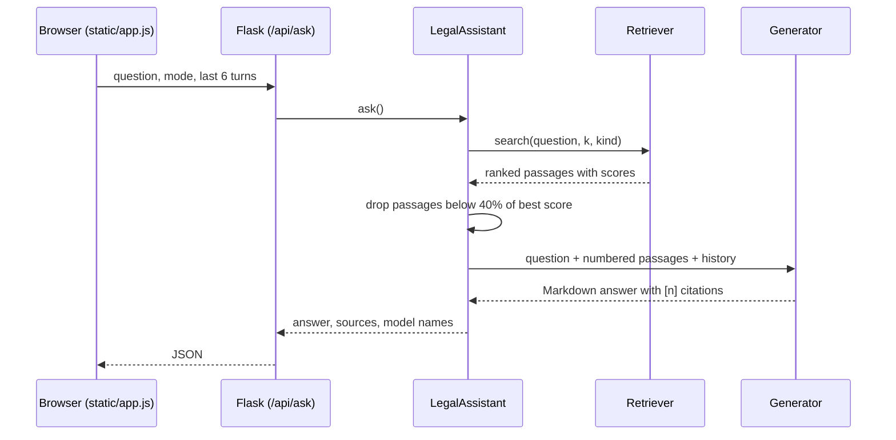

# Architecture

## Request flow

## Design decisions

**Why retrieval first.** v1 answered from a fixed block of 10 random CSV rows, so most questions were answered from unrelated text. v2 retrieves the passages that match each question, which is what makes citations possible.

**Why multilingual E5 by default.** Lawyers ask in Turkish, clients sometimes in English, and the corpus is Turkish. E5 maps both languages into one vector space. The model expects `query:` and `passage:` prefixes, which `EmbeddingRetriever` adds automatically.

**Why keep a TF-IDF fallback.** Some law firms cannot send documents to an external API or run a GPU. The TF-IDF retriever needs no download and handles Turkish morphology with two simple tools:
- correct Turkish lowercasing (`İ → i`, `I → ı`), which Python's `str.lower()` gets wrong;
- F5 stemming (first five letters of each word), a well-known baseline for agglutinative Turkish, combined with character 3–5-grams.

Its weakness is synonyms ("ev sahibi" vs "kiraya veren"); the embedding retriever handles those.

**Why the generator only sees retrieved passages.** The system prompt (`app/prompts.py`) tells the model to answer only from numbered sources, cite each claim, and never invent case numbers, dates or quotations. If the sources do not cover the question, it must say so.

**Case-law mode.** Half of the top-k slots go to case-law summaries, the rest to legislation, so an answer can explain both the rule and how courts apply it.

## Extending

- **New model provider:** add a class with `name` and `generate(question, hits, mode, history)` in `app/generator.py` and register it in `build_generator`.
- **Vector database:** `EmbeddingRetriever` keeps vectors in a NumPy matrix, which is fast up to tens of thousands of passages. For larger corpora, replace `search` with FAISS, Qdrant or pgvector.
- **Evaluation:** add question → expected-passage pairs to `tests/test_pipeline.py` to track retrieval quality as the corpus grows.
